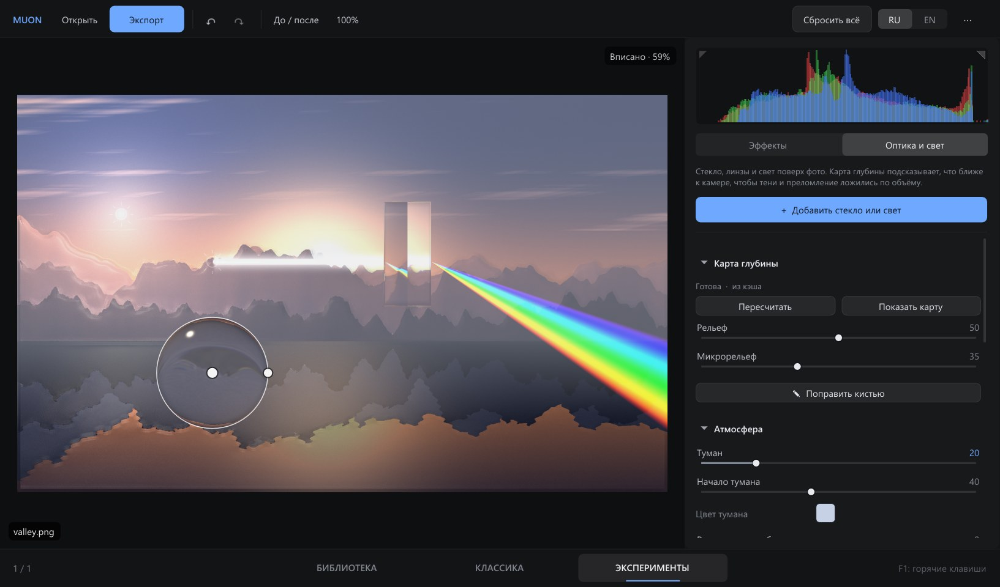

<h1 align="center">Muon</h1>

Быстрый фоторедактор RAW и JPEG для Windows: всё как в Lightroom плюс вкладка с экспериментальными эффектами. 
Без установки: распакуйте и запустите. Вся обработка идёт на видеокарте.

<a href="#english">English below</a>

## Скачать

Откройте [Releases](../../releases), скачайте `Muon-1.1.0-win64.zip`, распакуйте в любую папку и запустите `Muon.exe`.

**Требования:** Windows 10 или 11, 64 бит. Подойдёт любая видеокарта с DirectX 11, то есть почти всё, что выпущено после 2010 года. Если видеокарты нет, Muon работает на процессоре через программный рендер Windows, медленнее, но работает. Ничего доустанавливать не нужно.

**Предупреждение Windows при первом запуске.** У программы нет платной цифровой подписи, поэтому SmartScreen может показать «Windows защитила ваш компьютер». Нажмите «Подробнее», затем «Выполнить в любом случае». Это нужно сделать один раз.

## Возможности

### Классика
- **RAW** почти всех камер (CR2, CR3, NEF, ARW, RAF, ORF, RW2, DNG, PEF и ещё около 20 форматов), а также JPEG, PNG, TIFF, BMP, WebP и HEIC.
- **Основные:** баланс белого (пипетка и авто), экспозиция, контраст, света, тени, белые, чёрные, текстура, чёткость, устранение дымки, красочность, насыщенность, авто-тон.
- **Цвет и тон:** тоновая кривая по RGB и каналам, HSL на 8 цветов, цветокоррекция теней, средних тонов и светов, чёрно-белое с микшером.
- **Детали:** резкость с маскированием, шумоподавление (non-local means), коррекция оптики, виньетка, зерно.
- **Кадр:** пропорции, поворот, выравнивание горизонта, перспектива, отражение.
- **Маски:** линейная, радиальная, кисть, диапазон яркости, цветовой диапазон и диапазон глубины. Внутри маски доступен свой набор коррекций.
- **Контроль пересветов:** зажмите Alt, двигая экспозицию, света, тени, белые или чёрные.

### Эксперименты
Стек из 22 эффектов поверх основной обработки. Каждый слой можно ограничить диапазоном яркости, цветом или маской, поэтому ASCII можно оставить только в тенях, а неон только на синем.

ASCII, полутоновый растр и CMYK, дизеринг (Game Boy, CGA), плёночное зерно, свечение и ореол, сдвиг каналов, глитч, сортировка пикселей, живопись, неоновые контуры, градиентная карта, инфракрасная плёнка, тепловизор, засветка, постеризация, мозаика, VHS и кинескоп, калейдоскоп, тилт-шифт, искажения, замена цвета, ксерокопия.

### Оптика и свет
Вторая половина вкладки «Эксперименты». Нейросеть строит карту глубины снимка (что ближе к камере, что дальше), и по ней правильно ложатся свет, тени и преломление.
- **Стекло:** призма, линза (собирающая, рассеивающая, цилиндр), стеклянный шар, стекло (гладкое, рифлёное, волнистое, матовое), капли воды. Преломление по закону Снеллиуса с дисперсией по семи длинам волн, отражения по Френелю, блики и каустика от источников света.
- **Свет:** точечный источник, прожектор и узкий луч. Источник висит перед тем, что под ним, поэтому ближние предметы освещены сильнее дальних. Тени ложатся по рельефу, затенённые места подсвечиваются по-настоящему, есть блики, мягкое затенение в складках, свечение и лучи в воздухе. Луч, пропущенный через призму, раскладывается в спектр.
- **Атмосфера:** туман и размытие по глубине с выбором точки фокуса на фото.
- **Карта глубины** строится один раз (около 0,1 с на видеокарте) и запоминается. Её можно посмотреть и поправить кистью «ближе» или «дальше».
- **По глубине** можно ограничить и маску в «Классике», и любой экспериментальный эффект: например, ASCII только на заднем плане.
- Всё перемещается, вращается и масштабируется прямо на фото.

### Библиотека и пакетная работа
- Вкладка «Библиотека»: выберите папку, отметьте снимки (Ctrl, Shift, Ctrl+A) и импортируйте их в рабочую ленту.
- В ленте можно выбрать несколько фото и через правый клик скопировать настройки, вставить их, сбросить правки или экспортировать выбранные.
- Экспорт в JPEG (с лимитом размера файла), PNG или TIFF 8/16 бит, с изменением размера, резкостью для экрана или печати, водяным знаком и шаблоном имени файла.

### Пресеты, которыми удобно делиться
Пресет хранит только выбранные группы настроек и применяется только к ним. При наведении результат сразу виден на фото. Пресет можно сохранить в файл `.muonpreset` или скопировать как одну строку `MUON1-...` и отправить в любом мессенджере. Получатель нажимает «Вставить код». Код защищён контрольной суммой, лишний текст вокруг и переносы строк не мешают.

## Как это работает

- **Язык и графика.** Программа написана на C++17. Интерфейс сделан на [Dear ImGui](https://github.com/ocornut/imgui) и рисуется через Direct3D 11.
- **Декодирование.** RAW читает [LibRaw](https://www.libraw.org): демозаик, баланс белого камеры, линейные 16 бит без тоновой кривой. JPEG, PNG, TIFF и прочие форматы читает Windows Imaging Component, встроенный в систему.
- **Обработка на видеокарте.** Исходник загружается на видеокарту один раз. Каждая правка вызывает цепочку пиксельных шейдеров HLSL в 16-битном float: геометрия и оптика, шумоподавление, проявка (баланс белого, экспозиция, локальный тон в логарифмической шкале, мягкий «плечевой» перегиб светов, кривые, HSL, цветокоррекция), маски, резкость, виньетка и зерно, затем стек экспериментальных эффектов.
- **Превью и экспорт.** Превью считается в разрешении экрана, поэтому ползунки отзываются за миллисекунды. При увеличении и при экспорте та же цепочка считается в полном разрешении.
- **Видеокарта.** Muon сам выбирает самую мощную карту: на ноутбуке дискретную, а не встроенную. Выбрать вручную можно в меню «···» → «Видеокарта».
- **Правки.** Исходные файлы никогда не меняются. Правки хранятся рядом с фото в файле `имя.ext.muon`. Если папка защищена от записи, они хранятся в `%LOCALAPPDATA%\Muon\sidecars`. Отмена работает по шагам.
- **Особые RAW.** Режимы Nikon High Efficiency и High Efficiency★ используют закрытый кодек, который не читает ни одна открытая библиотека. Такие файлы открываются через встроенный в них полноразмерный JPEG, и программа об этом предупреждает.
- **Карта глубины.** Её считает нейросеть [Depth Anything V2 Small](https://github.com/DepthAnything/Depth-Anything-V2) через [ONNX Runtime](https://onnxruntime.ai) и DirectML, то есть на любой видеокарте с DirectX 12, а без неё на процессоре. Модуль лежит в папке `depth` рядом с `Muon.exe` (около 85 МБ). Если папку удалить, всё остальное работает как раньше, а оптика считает сцену плоской.
- **Сбои.** Если Muon всё же упадёт, отчёт сохранится в `%LOCALAPPDATA%\Muon\crash`, а правки к этому моменту уже будут записаны.

## Горячие клавиши

| Клавиши | Действие |
|---|---|
| Ctrl+O / Ctrl+E | Открыть / экспорт |
| Ctrl+Z / Ctrl+Y | Отменить / повторить |
| Ctrl+Shift+C / V | Копировать / вставить настройки |
| G / D | Библиотека / классика |
| R / M | Кадр / маски |
| \\ | До и после |
| Z | Вписать или 100% |
| ← → | Предыдущее и следующее фото |
| Alt + ползунок | Показать пересветы и провалы |
| F1 | Все горячие клавиши |

## Сборка из исходников

Понадобятся Visual Studio 2022 с компонентом «Разработка классических приложений на C++», CMake и Git. Запустите `build.bat`: скрипт сам скачает LibRaw и Dear ImGui нужных версий и соберёт `Muon.exe` в корне проекта. CRT линкуется статически, поэтому exe не требует Visual C++ Redistributable.

Самопроверка всех стадий обработки: `Muon.exe --selftest фото.jpg папка_для_результатов`.

## Лицензия

Код Muon распространяется по лицензии MIT, см. [LICENSE](LICENSE). Сторонние библиотеки перечислены в [THIRD_PARTY_NOTICES.md](THIRD_PARTY_NOTICES.md).

---

## English

Muon is a fast RAW and JPEG photo editor for Windows. There is nothing to install, and all processing runs on the GPU.

**Download:** grab `Muon-1.1.0-win64.zip` from [Releases](../../releases), unzip and run `Muon.exe`.

**Requirements:** Windows 10 or 11, 64-bit, and any DirectX 11 graphics card. Without a usable GPU, Muon falls back to Windows' software renderer, which is slower but works. SmartScreen may warn on first launch because the exe is not code-signed: click "More info", then "Run anyway".

**What's inside:**
- **Classic tab.** A Lightroom-style develop module: white balance, tone, presence, curves, HSL, colour grading, B&W mixer, sharpening, noise reduction, lens corrections, crop and perspective, and masks (linear, radial, brush, luminance and colour ranges).
- **Experiments tab.** 22 stackable effects, each of which can be limited to a brightness range, a colour or a mask.
- **Optics & light.** Prisms, lenses, glass spheres, fluted or frosted glass and water drops with real refraction, dispersion and caustics, plus point lights, spotlights and beams. A neural depth map (Depth Anything V2) makes light falloff, shadows, fog and depth blur follow the scene, and masks and effects can be limited to a depth range.
- **Library tab.** Imports photos into a working filmstrip with multi-select, copy and paste of settings, and batch export.
- **Shareable presets.** Save them as `.muonpreset` files or as one-line `MUON1-...` codes.

**How it works:**
- **Decoding.** LibRaw decodes RAW files to linear 16-bit; other formats use the Windows Imaging Component.
- **GPU pipeline.** A chain of HLSL pixel shaders runs in 16-bit float: geometry, noise reduction, develop, masks, sharpening and effects.
- **Preview and export.** The preview renders at screen resolution and export at full resolution.
- **Depth map.** Depth Anything V2 Small runs through ONNX Runtime with DirectML from the optional `depth` folder (about 85 MB). Without it Muon treats the scene as flat.
- **Non-destructive edits.** Edits are stored next to each photo in a `.muon` sidecar; originals are never modified.

**Building:** install Visual Studio 2022 (C++ desktop workload), CMake and Git, then run `build.bat`. It also downloads the depth module with `tools/fetch_depth.ps1`.

**License:** MIT. See [THIRD_PARTY_NOTICES.md](THIRD_PARTY_NOTICES.md) for LibRaw (CDDL 1.0), Dear ImGui (MIT), ONNX Runtime (MIT), DirectML and Depth Anything V2 (Apache 2.0).
